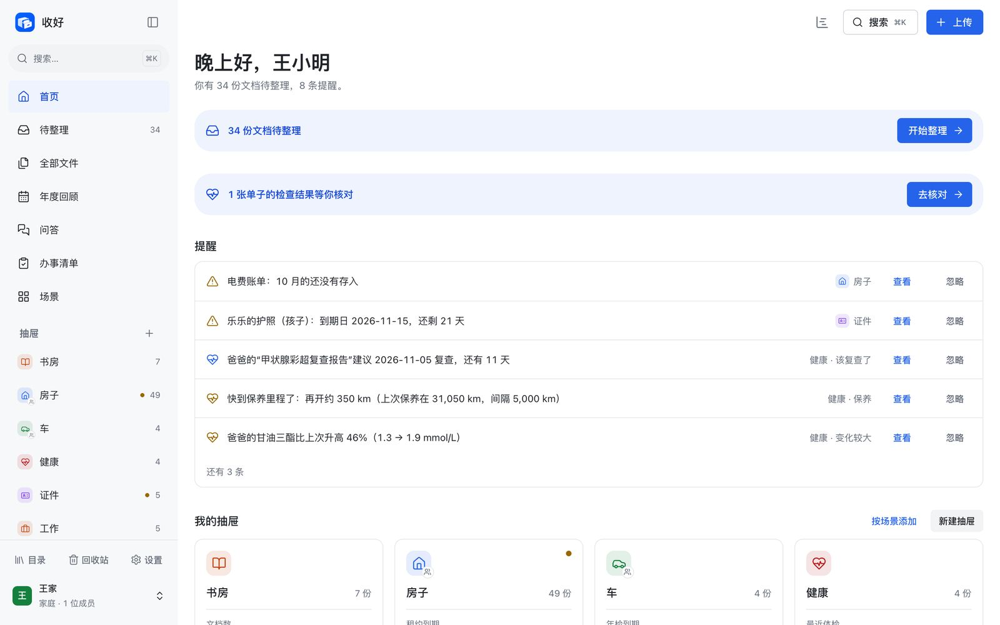
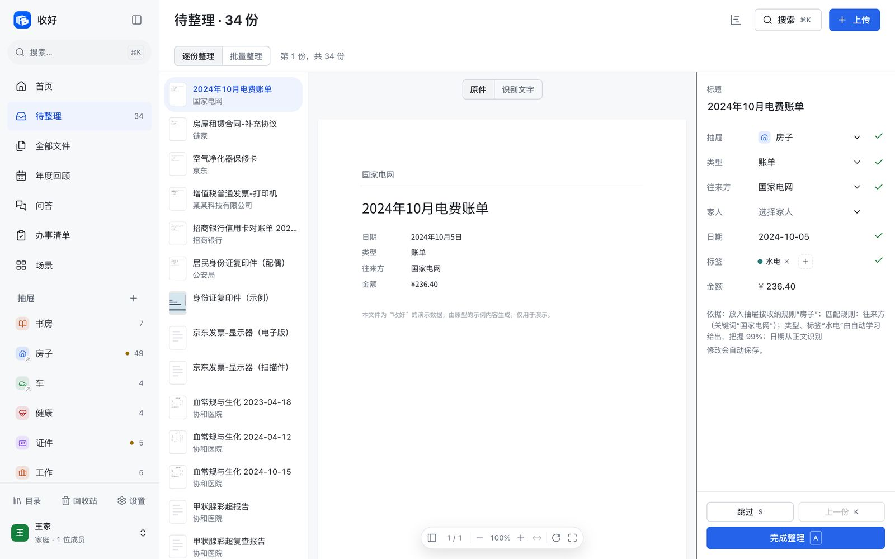
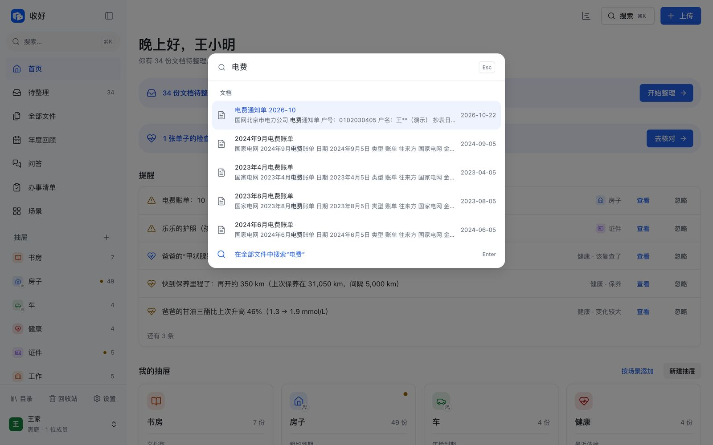
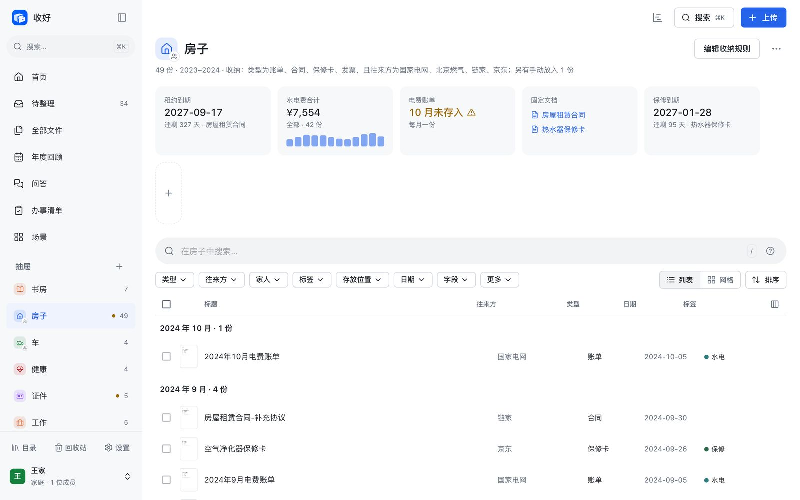
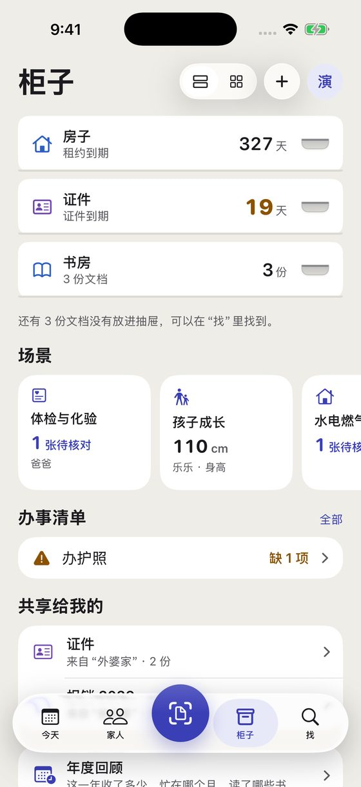

# 收好 Kept

自托管、中文友好的文档管理系统：把纸质单据和电子文件交给它，自动完成文字识别、归类和索引，随时能找到。按生活事务把文档放进“抽屉”，提炼要点和到期提醒，每年生成一份年度回顾。附带个人图书馆。

这是收好的开源版本（免费版）。

## 免费版包含什么

- **收**：网页上传、监听目录、手机上传；PDF、图片、Office、邮件等格式；中英文文字识别。
- **理**：自动分类、抽屉与要点、到期提醒、自定义字段、待整理、常用筛选、办事清单、页面编辑、拆分合并。
- **找**：中文全文搜索、边输边搜、筛选与排序（中文按拼音排）、各种格式的预览；往来方、类型、标签可以用拼音查找。
- **用**：单份文档的分享链接、年度回顾、书房（书目、EPUB 阅读、划线、书单）。
- **安全与数据**：两步验证、敏感文档、本机备份与恢复、导出整个空间。数据永远拿得走。
- 最多 6 个成员，1 个家庭空间，另外每人有自己的个人空间；文档份数不限。
- 数据库默认 SQLite，也可以用 Postgres。

收好另有收费版和企业版，加上 AI、家人的私密文档与紧急访问、场景、外部存储与云端加密、邮件收取、工作流、分享增强，以及单点登录、配额等团队功能。这些部分不在这个仓库里。开源版能读取、解密、搬回由官方版本留下的数据，换过来也不会丢东西。

## 界面预览

<table>
<tr>
<td></td>
<td></td>
</tr>
<tr>
<td></td>
<td></td>
</tr>
</table>



## 快速开始

用 Docker（只需一个数据卷）：

```bash
docker build -f deploy/Dockerfile -t kept .
docker run -d --name kept -p 8000:8000 -v kept-data:/data kept
```

打开 `http://localhost:8000`，按提示创建管理员。不用 Docker 的二进制部署、配置项、备份与恢复见 [docs/部署.md](docs/部署.md)。

本地开发，服务端（需要 Go 1.26+；文字识别需要 ocrmypdf、tesseract 中英文语言包、poppler）：

```bash
cd server
make run          # 监听 :8000，数据放在 server/data
```

网页端（需要 Node.js 22 和 pnpm）：

```bash
cd app
pnpm install
pnpm dev          # http://localhost:5173，接口转发到 :8000
```

一体化运行：`cd server && make web build && ./bin/kept serve`

## 目录

| 目录 | 内容 |
|---|---|
| [`api/`](api) | OpenAPI 接口定义 |
| [`server/`](server) | Go 服务端，见 [server/README.md](server/README.md) |
| [`app/`](app) | 网页端（Vite + React + MUI），见 [app/README.md](app/README.md) |
| [`deploy/`](deploy) | Dockerfile、docker-compose 示例、systemd 服务与安装脚本 |
| [`docs/`](docs) | 部署说明 |

## 许可证

收好的开源版本以 [GNU Affero General Public License v3.0](LICENSE)（AGPL-3.0）发布。修改后用来对外提供网络服务时，也要向使用者公开修改后的源码。

用到的第三方软件及其许可证见 [THIRD_PARTY_NOTICES.md](THIRD_PARTY_NOTICES.md)。

## 参与

欢迎提交问题和改动，见 [CONTRIBUTING.md](CONTRIBUTING.md)。合入改动前需要签署[贡献者协议](CLA.md)。
